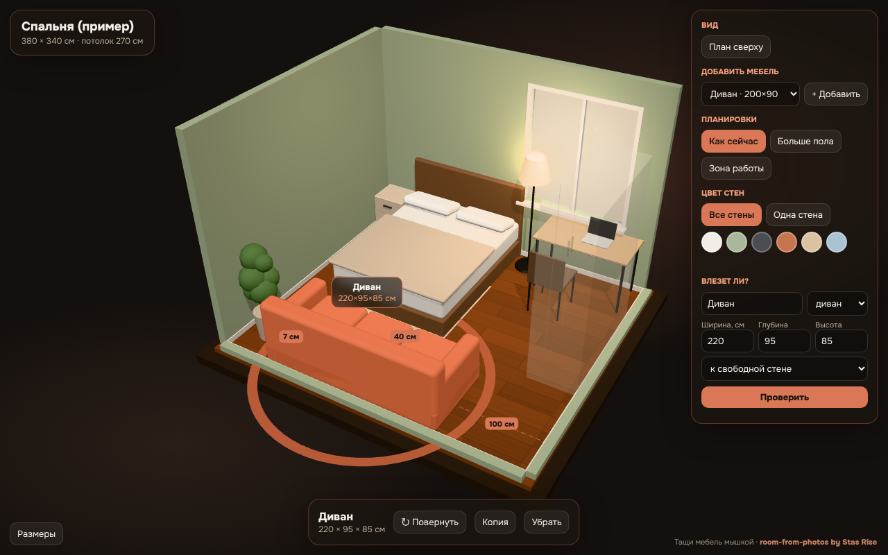

# room-from-photos by Stas Rise

**Сфоткай комнату — Claude соберёт её в 3D прямо в браузере.**
Тащи мебель мышкой, проверь, влезет ли новый диван, перекрась стены, сравни планировки. Все размеры, которые Claude угадал по фото, выписаны в таблице — сверь их рулеткой.



## Что умеет
- 3D-«кукольный домик» без потолка из 2–4 обычных фото с телефона.
- Размеры по известным предметам в кадре (дверь, розетка, кровать) + честная пометка «перемерь» там, где Claude не уверен.
- Перетаскивание мебели, поворот (R), мебель не проходит сквозь стены и друг друга, расстояния до соседей в сантиметрах.
- Цвет стен: все сразу или одна стена.
- 3 планировки на выбор и каталог мебели «+ Добавить».
- Шторы, картины, батареи, кухня — комната выглядит как настоящая.
- «Влезет ли?»: вводишь размеры — предмет встаёт к свободной стене или ответ «не хватает N см». Учитываются двери, окна, батареи.
- Вид сверху как план.
- Один HTML-файл, работает без интернета.

## Установка

**Claude Code**
```
/plugin marketplace add irina196618-rgb/room-from-photos
/plugin install room-from-photos@stas-rise
```
или
```
npx skills@latest add irina196618-rgb/room-from-photos
```

**claude.ai / приложение Claude** (подходит любой тариф, в том числе бесплатный):
1. Скачай [room-from-photos.zip](room-from-photos.zip) (кнопка Download).
2. Настройки → Возможности → включи «Создание и редактирование файлов» (Code execution).
3. Customize → Skills → «+» → Create skill → Upload a skill → выбери ZIP.

## Как пользоваться
1. Сделай 2 фото: одно от двери, второе из противоположного угла. Дверь должна попасть в кадр — по ней Claude считает масштаб.
2. Отправь Claude фото и напиши: «Собери 3D моей комнаты».
3. Открой файл, который пришлёт Claude.

Готовые запросы:
- «Переставь мебель так, чтобы у окна появилось рабочее место»
- «Перекрась стену за кроватью в шалфей»
- «Влезет ли диван 220 × 95 см к левой стене?»

Знаешь хоть один реальный размер (ширину комнаты, длину дивана)? Скажи Claude — он пересчитает всё точнее.

## Точность
Размеры по фото — примерные, ошибка 5–15 %. Перед покупкой мебели — рулетка.

## Почему этот скилл появился
Оригинальный скилл room-from-photos (SkylarKitchen/skills) удалили с GitHub в ноябре 2026 года. Этот скилл написан заново с нуля, его код не основан на оригинале. Лицензия MIT — пользуйтесь свободно.

---
Stas Rise · ИИ без воды · Telegram: @stas_rise

## English
Send Claude 2–4 phone photos of a room and get an interactive 3D dollhouse in a single HTML file: estimated sizes with confidence, draggable furniture with collisions, wall colours, 3 layouts, a "will it fit?" check and a top-down plan. Install: `/plugin marketplace add irina196618-rgb/room-from-photos` → `/plugin install room-from-photos@stas-rise`. MIT.
